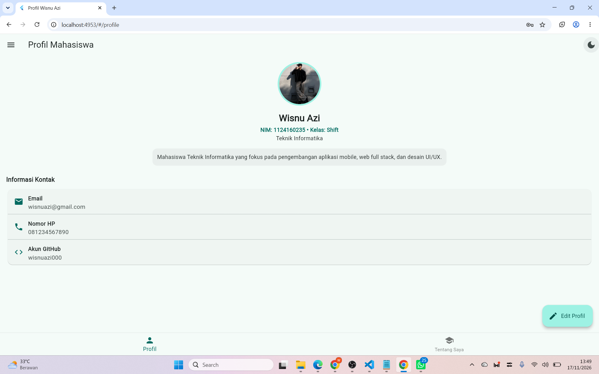
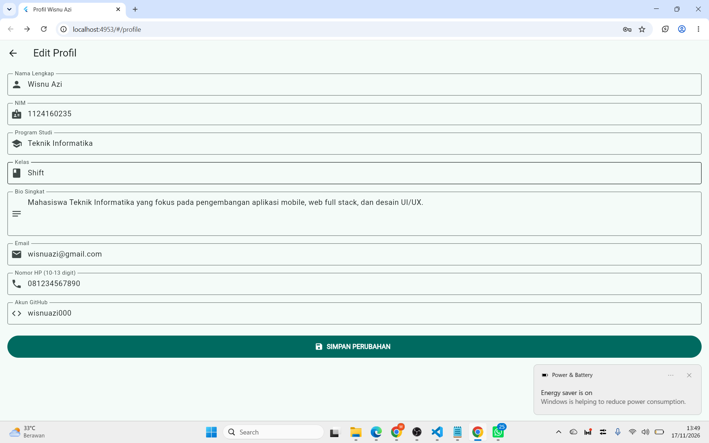

# UTS Aplikasi Mobile

- **Nama:** Wisnu Azi
- **NIM:** 1124160235
- **Prodi:** Teknik Informatika 
- **Jurusan:** Software Enginering
- **Kelas:** Shift

## Struktur Repository
- `soal1-live-coding/` — Aplikasi Profil Mahasiswa (StatelessWidget)
- `soal2-profil-app/` — Aplikasi Profil Mahasiswa Android (Login, Profil, Edit Profil, Tentang Saya, Dark Mode)

## Daftar Fitur Soal 2
1. **Login Page:** Form validasi email & password, simulasi loading asynchronous, dan navigasi `pushReplacementNamed`.
2. **Profile Page:** Foto dari `assets/images/profile.jpg`, biodata lengkap, kartu kontak (`Card` + `ListTile`), `Drawer`, `BottomNavigationBar`, dan `FloatingActionButton`.
3. **Edit Profile Page:** Pre-filled `TextEditingController`, validasi nama wajib diisi, email valid, nomor HP 10–13 digit angka, serta update langsung via `Navigator.pop` & `setState()`.
4. **About Page:** Daftar keahlian/hobi dan riwayat pendidikan menggunakan `ListView`.
5. **Dynamic Theme:** Switch pergantian mode terang dan mode gelap secara langsung di dalam aplikasi.

## Screenshot Aplikasi
| Halaman Login | Halaman Profil | Halaman Edit Profil |
| :---: | :---: | :---: |
|  |  |  |

## Cara Menjalankan Proyek Soal 2
```bash
git clone https://github.com/Wisnuazi000/uts-pml-1124160235.git
cd uts-pml-1124160235
cd soal2-profil-app
flutter pub get
flutter run
flutter build apk --release